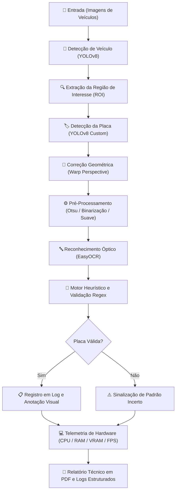

# 🐍 VIPER — Vehicle Identification and Plate Extraction Recognition

<div align="center">

[](https://www.python.org/)
[](https://pytorch.org/)
[](https://github.com/ultralytics/ultralytics)
[](https://opencv.org/)
[](https://github.com/JaidedAI/EasyOCR)
[](#-testes-automatizados)
[](CONTRIBUTING.md)

**Sistema Inteligente de Detecção de Veículos, Localização de Placas e Reconhecimento Óptico de Caracteres (ALPR)**  
*Suporte aos Padrões Brasileiros Mercosul (`ABC1D23`) e Antigo (`ABC1234`), com Correção Geométrica e Telemetria de Hardware em Tempo Real.*

</div>

---

## 📌 Sumário

- [Visão Geral](#-visão-geral)
- [Principais Destaques](#-principais-destaques)
- [Arquitetura e Pipeline](#-arquitetura-e-pipeline)
- [Resultados Visuais](#-resultados-visuais)
- [Tecnologias Utilizadas](#-tecnologias-utilizadas)
- [Módulos do Sistema](#-módulos-do-sistema)
- [Benchmark e Desempenho](#-benchmark-e-desempenho)
- [Estrutura do Repositório](#-estrutura-do-repositório)
- [Instalação e Início Rápido](#-instalação-e-início-rápido)
- [Como Executar](#-como-executar)
- [Testes Automatizados](#-testes-automatizados)
- [Contribuição](#-contribuição)
- [Autoria](#-autoria)

---

## 🔍 Visão Geral

O **VIPER** (*Vehicle Identification and Plate Extraction Recognition*) é uma solução de **ALPR** (*Automatic License Plate Recognition*) desenvolvida com foco em ambientes institucionais e controle de acesso veicular (como campus universitários e estacionamentos corporativos).

O sistema combina modelos de **Deep Learning (YOLOv8)** para detecção em dois níveis (veículo e placa), técnicas avançadas de **Processamento Digital de Imagens (PDI)** para alinhamento geométrico por perspectiva e binarização adaptativa, **OCR (EasyOCR)** e um motor de **regras heurísticas** para desambiguação de caracteres e validação dos padrões brasileiros.

Além do reconhecimento visual, o VIPER integra um módulo nativo de **telemetria de hardware**, permitindo monitorar consumo de CPU, memória RAM, alocação de GPU/VRAM, latência e taxa real de processamento (FPS *End-to-End*).

---

## ⚡ Principais Destaques

- **Pipeline Hierárquico de Detecção**: Localiza o veículo na imagem ampla e, na sequência, isola a placa veicular com alta precisão.
- **Retificação e Correção Geométrica**: Detecção de quadrilátero com correção de perspectiva (*Warp Perspective*), gerando imagens frontais alinhadas para o OCR mesmo com placas inclinadas.
- **Pré-processamento Avançado**: Binarização automática de Otsu, equalização CLAHE e redimensionamento *Letterbox* com preservação de aspect ratio.
- **Suporte aos Padrões Brasileiros**:
  - **Padrão Mercosul**: `LLLNLNN` (Ex.: `ABC1D23`)
  - **Padrão Antigo Brasileiro**: `LLLNNNN` (Ex.: `ABC1234`)
- **Desambiguação Heurística Posicional**: Corrige automaticamente confusões clássicas de OCR (ex.: `0` e `O`, `1` e `I`, `8` e `B`, `5` e `S`) com base na posição da letra ou número exigida pelo padrão da placa.
- **Tratamento de Ruídos de Borda**: Mecanismo que identifica e remove ruídos periféricos em leituras de 8 caracteres.
- **Telemetria e Benchmarking Integrados**: Registro instantâneo de métricas de hardware por execução (CPU %, RAM MB, VRAM MB, latência ms, FPS).
- **Relatório Executivo Automatizado**: Geração de documentos técnicos em formato PDF via ReportLab.

---

## 🏗️ Arquitetura e Pipeline

O fluxo de processamento do VIPER é dividido em etapas desacopladas:



---

## 📷 Resultados Visuais

Amostras do pipeline em execução com imagens do diretório `fotos_carros/`:

| Imagem Original (`fotos_carros/`) | Placa Binarizada (`placas_processadas/`) | Detecção Anotada (`debug_saida_viper/`) | Placa Reconhecida | Padrão |
|:---:|:---:|:---:|:---:|:---:|
| `car01.jpeg` | `limpa_car01.jpeg` | `anotado_car01.jpeg` | **CDV2I72** | Mercosul |
| `car02.jpeg` | `limpa_car02.jpeg` | `anotado_car02.jpeg` | **IOZ4I93** | Mercosul |
| `car03.jpeg` | `limpa_car03.jpeg` | `anotado_car03.jpeg` | **GGC8H75** | Mercosul |
| `car04.jpeg` | `limpa_car04.jpeg` | `anotado_car04.jpeg` | **POX4G21** | Mercosul |
| `car05.jpeg` | `limpa_car05.jpeg` | `anotado_car05.jpeg` | **BRA3R52** | Mercosul |

> *Taxa de aprovação de 100% no conjunto de imagens de teste integrado com tempo médio total de 258 ms por veículo.*

---

## 💻 Tecnologias Utilizadas

| Componente | Ferramenta / Biblioteca | Finalidade |
|---|---|---|
| **Linguagem** | Python 3.10+ | Linguagem principal do projeto |
| **Deep Learning** | Ultralytics YOLOv8 & PyTorch | Detecção de veículos e detector customizado de placas |
| **Visão Computacional** | OpenCV | Processamento digital de imagem, warp perspective e binarização |
| **OCR** | EasyOCR | Reconhecimento óptico de caracteres com pesos pré-treinados |
| **Manipulação Numérica** | NumPy & Pillow | Transformações matriciais e manipulação de canais de cor |
| **Validação** | Expressões Regulares (Regex) | Validação estrita dos formatos Mercosul e padrão antigo |
| **Telemetria** | `psutil` & `torch.cuda` | Monitoramento contínuo de uso de CPU, RAM e VRAM |
| **Relatórios** | ReportLab | Geração programática de relatórios consolidados em PDF |
| **Testes** | Pytest | Testes automatizados de validação de regras e telemetria |

---

## 📦 Módulos do Sistema

O núcleo de código do VIPER está estruturado de forma modular no diretório `src/`:

```text
VIPER/
├── src/
│   ├── main.py                 # Pipeline integrado de ponta a ponta
│   ├── reading.py              # Módulo de OCR e motor heurístico de validação
│   ├── preProcessing.py        # Algoritmos de retificação e binarização de placas
│   ├── telemetria.py           # Monitoramento de hardware (CPU, RAM, GPU, VRAM)
│   ├── trainYOLO.py            # Rotina de treinamento com callbacks de telemetria
│   ├── validadeYOLO.py         # Benchmark de latência, FPS e métricas do YOLO
│   └── gerar_pdf_relatorio.py  # Geração do relatório executivo em PDF
├── tests/                      # Bateria de testes unitários com pytest
├── Makefile                    # Atalhos de compilação, execução e testes
├── requirements.txt            # Dependências de execução
└── requirements-dev.txt        # Dependências de desenvolvimento e testes
```

### 1. Pipeline Principal (`main.py` / `src/main.py`)
Coordena todas as etapas do sistema: recebe as imagens de veículos, detecta o automóvel, recorta a área de interesse, localiza a placa, aplica retificação e binarização, submete ao EasyOCR, valida a sintaxe e grava as anotações visuais e logs.

### 2. Leitura e Heurística de Caracteres (`reading.py` / `src/reading.py`)
Implementa:
- Normalização e limpeza de caracteres ilegais.
- Desambiguação inteligente entre caracteres com semelhança visual (`0` ↔ `O`, `1` ↔ `I`, `2` ↔ `Z`, `5` ↔ `S`, `8` ↔ `B`, `4` ↔ `A`).
- Tratamento de ruídos nas extremidades (strings de 8 caracteres).
- Filtro de confiança do OCR e cálculo de IoU.

### 3. Pré-processamento e PDI (`preProcessing.py` / `src/preProcessing.py`)
- `encontrar_quadrilatero_placa`: encontra os 4 vértices da placa com base em contornos e aproximação poligonal.
- `warp_placa`: realiza transformação afim/perspectiva (`cv2.warpPerspective`) para frontalizar a placa.
- `letterbox`: redimensionamento proporcional com preenchimento cinza neutro.

### 4. Telemetria de Hardware (`src/telemetria.py`)
Coleta indicadores essenciais para avaliação de viabilidade do sistema em hardware de borda (*Edge Computing* / embarcados):
- Percentual de CPU Host.
- Memória RAM consumida e percentual do sistema.
- VRAM alocada, reservada e pico de memória na GPU.
- Temporizadores de alta precisão com `time.perf_counter()`.

### 5. Geração de Relatórios em PDF (`gerar_pdf_relatorio.py`)
Consolida métricas e estatísticas em um documento PDF formatado profissionalmente, salvo em `relatorios/relatorio_viper_projeto.pdf`.

---

## 📊 Benchmark e Desempenho

Validação realizada em ambiente com aceleração gráfica **NVIDIA GeForce RTX 3050 Laptop GPU**:

| Métrica | Resultado Obtido |
|---|---|
| **Forward Pass (Inferência YOLO)** | **4.58 ms** |
| **Pré-processamento Médio** | **0.01 ms** |
| **Pós-processamento / NMS** | **0.87 ms** |
| **Latência Total End-to-End** | **5.46 ms** |
| **Taxa de Quadros Real (FPS)** | **183.29 FPS** |
| **Pico de Memória VRAM** | **56.37 MB** |
| **Taxa de Leitura no Teste Integrado** | **100% (5/5 imagens)** |

---

## 📂 Estrutura do Repositório

```text
VIPER/
├── .github/workflows/ci.yml       # Integração contínua (GitHub Actions)
├── Makefile                       # Comandos rápidos de automação
├── README.md                      # Documentação completa do projeto
├── CONTRIBUTING.md                # Guia de contribuição e boas práticas
├── requirements.txt               # Dependências principais
├── requirements-dev.txt           # Dependências de teste e linters
├── data.yaml                      # Configuração de dados para treinamento YOLO
├── main.py                        # Ponto de entrada do pipeline principal
├── reading.py                     # Ponto de entrada para testes de OCR
├── preProcessing.py               # Ponto de entrada para testes de PDI
├── trainYOLO.py                   # Ponto de entrada para treinamento
├── validadeYOLO.py                # Ponto de entrada para benchmark de latência
├── gerar_pdf_relatorio.py         # Ponto de entrada para geração do PDF
├── fotos_carros/                  # Amostras de entrada para testes
├── placas_processadas/            # Placas recortadas e binarizadas
├── debug_saida_viper/             # Imagens anotadas e logs de auditoria
├── relatorios/                    # Documentos técnicos e relatórios em PDF
│   └── relatorio_viper_projeto.pdf
├── runs/detect/                   # Pesos e métricas de treinamento YOLO
├── src/                           # Código-fonte modular do sistema
└── tests/                         # Testes automatizados com pytest
```

---

## 🚀 Instalação e Início Rápido

### Pré-requisitos
- Python 3.10 ou superior
- Git
- Placa de vídeo compatível com CUDA (opcional; o sistema funciona também em CPU)

### 1. Clonar o Repositório
```bash
git clone https://github.com/marian4cost/VIPER.git
cd VIPER
```

### 2. Criar e Ativar o Ambiente Virtual

**Linux / macOS:**
```bash
python3 -m venv .venv
source .venv/bin/activate
```

**Windows:**
```powershell
python -m venv .venv
.venv\Scripts\activate
```

### 3. Instalar Dependências

Utilizando o `Makefile`:
```bash
make install
```

Ou diretamente via `pip`:
```bash
pip install -r requirements.txt
```

Para instalar dependências de desenvolvimento e testes:
```bash
make install-dev
```

---

## 🏃 Como Executar

O projeto disponibiliza pontos de entrada simples na raiz para cada funcionalidade:

### 1. Executar o Pipeline Integrado Completo
Processa as fotos de veículos da pasta `fotos_carros/`, realiza o alinhamento da placa, OCR e grava os resultados em `debug_saida_viper/` e no log de acessos:
```bash
make run
# ou: python main.py
```

### 2. Executar Apenas Testes de Leitura e Heurística de Placas
```bash
python reading.py
```

### 3. Executar Testes de Pré-Processamento e Binarização
```bash
python preProcessing.py
```

### 4. Executar Benchmark de Latência e Validação YOLO
Mede os tempos de pré-processamento, forward pass e taxa de FPS real:
```bash
make validate
# ou: python validadeYOLO.py
```

### 5. Iniciar Treinamento do Modelo de Detecção de Placas
```bash
make train
# ou: python trainYOLO.py
```

### 6. Gerar Relatório Executivo em PDF
Consolida métricas de todo o sistema no arquivo `relatorios/relatorio_viper_projeto.pdf`:
```bash
make report
# ou: python gerar_pdf_relatorio.py
```

---

## 🧪 Testes Automatizados

O VIPER conta com uma suíte de testes unitários para validar a lógica de regras de placas, telemetria e pré-processamento:

```bash
make test
# ou: pytest -v
```

Saída esperada:
```text
tests/test_preprocessing.py::test_recortar_roi_suave_dimensions PASSED
tests/test_reading.py::test_validar_placa_mercosul_valida PASSED
tests/test_reading.py::test_validar_placa_antiga_valida PASSED
tests/test_reading.py::test_correcao_letras_numeros_mercosul PASSED
tests/test_reading.py::test_correcao_ruido_8_caracteres PASSED
tests/test_reading.py::test_placa_invalida_retorna_incerto PASSED
tests/test_telemetria.py::test_capturar_desempenho_maquina PASSED
tests/test_telemetria.py::test_formatar_relatorio_hardware PASSED
tests/test_telemetria.py::test_temporizador PASSED
============================== 9 passed ==============================
```

---

## 🤝 Contribuição

Contribuições, correções e sugestões de melhoria são muito bem-vindas!  
Consulte o guia detalhado em [CONTRIBUTING.md](CONTRIBUTING.md) para saber como configurar o ambiente, executar testes e submeter seus Pull Requests.

---

## 👩‍💻 Autoria

Desenvolvido por **Mariana Costa** no contexto de pesquisa e desenvolvimento em visão computacional, Deep Learning e reconhecimento automático de placas veiculares (ALPR).

- GitHub: [@marian4cost](https://github.com/marian4cost)
- Repositório do Projeto: [marian4cost/VIPER](https://github.com/marian4cost/VIPER)
